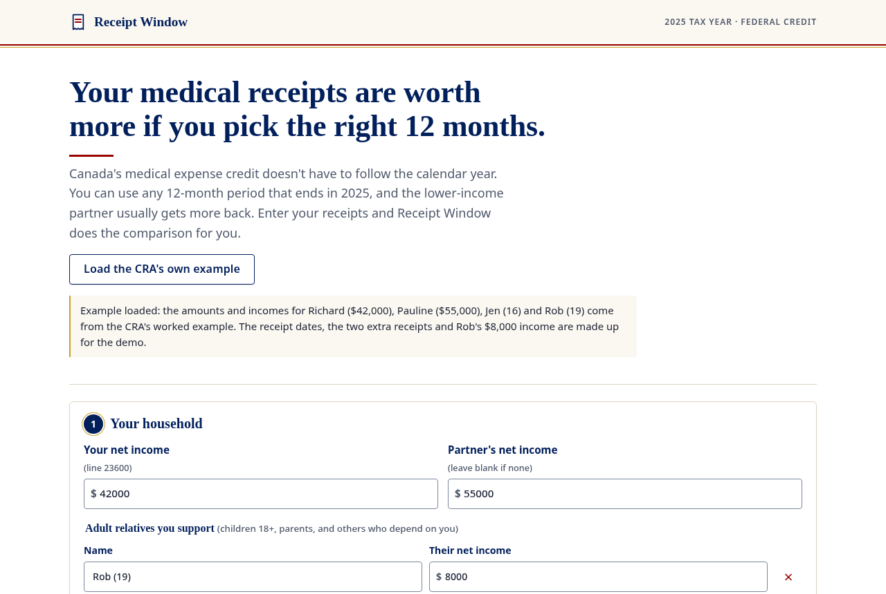

# Receipt Window

Get the most from Canada's medical expense tax credit by picking the right 12 months and the right person to claim.

**Live demo:** https://alenzacodes.github.io/receipt-window/



## Why

Medical receipts usually get added up for January to December. The CRA allows something better: any 12-month period that ends in the tax year, claimed by either partner. Because the claim is reduced by 3% of the claimer's net income (up to $2,834), the lower-income partner usually gets more back, and a period like July to June can catch a big dental bill that a calendar year would split in half.

The CRA's own example shows it. Richard and Pauline have $6,300 in family expenses. Pauline earns $55,000 and could claim $4,650. Richard earns $42,000 and could claim $5,040. Same receipts, $390 more claimed (about $57 off federal tax), just by choosing who files them. Because the credit only reduces tax owed, Receipt Window also checks that the claimer has enough federal tax for the credit to use.

## What it does

- You enter your net income, your partner's, and any adult relatives you support.
- You add receipts: date, who it was for, what it was (from the CRA's list of common expenses), the amount and what insurance paid.
- It tries every 12-month period that starts or ends on one of your receipt dates and ends in 2025, works out both partners' claims for each, and keeps the best.
- It shows the claim, the federal credit, who should claim, and a timeline of which receipts fall inside the period.
- It lists what to keep on file: prescriptions, written certifications or Form T2201 for items that need them, plus receipts that aren't eligible (over-the-counter drugs, vitamins, gym fees) and receipts that fall outside the period and may carry to next year.

Nothing is uploaded. It runs in your browser and saves to `localStorage` so you can come back.

## The rules it uses (2025 tax year)

| Rule | Value | Source |
| --- | --- | --- |
| Period | Any 12 months ending in 2025, not claimed in 2024 | CRA lines 33099 and 33199 |
| Reduction | Lesser of 3% of net income or $2,834 | CRA lines 33099 and 33199 |
| Line 33099 | You, your partner, your children under 18, claimed by one partner | CRA lines 33099 and 33199 |
| Line 33199 | Other dependants, using the dependant's own net income | CRA lines 33099 and 33199 |
| Federal credit rate | 14.5% (the lowest rate fell from 15% to 14% on July 1, 2025) | CRA what's new for 2025 |

- https://www.canada.ca/en/revenue-agency/services/tax/individuals/topics/about-your-tax-return/tax-return/completing-a-tax-return/deductions-credits-expenses/lines-33099-33199-eligible-medical-expenses-you-claim-on-your-tax-return.html
- https://www.canada.ca/en/revenue-agency/services/tax/individuals/topics/about-your-tax-return/tax-return/completing-a-tax-return/whats-new.html

## Limits

- Federal credit only. Your province adds its own credit with its own threshold and rate.
- Leaves out the refundable medical expense supplement, the top-up tax credit, the disability supports deduction and the rules for someone who died.
- Uses one 12-month period for everyone in the household.
- The expense list is a subset of the CRA's. "Something else" is counted but flagged to check.
- An estimate, not tax advice.

## Run it

Plain HTML, CSS and JavaScript. No build step.

```
python3 -m http.server 8000
node test.js
```

`test.js` checks the CRA's Richard and Pauline numbers, the period maths (including a February 29 start), reimbursed and ineligible receipts, and that the planner beats the calendar year when it should.

| File | What's in it |
| --- | --- |
| `rules.js` | 2025 threshold, rate and the expense list |
| `calc.js` | Pure functions: periods, reduction, the planner |
| `app.js` | Forms, timeline, summary and saving |

## License

MIT. See [LICENSE](LICENSE).
